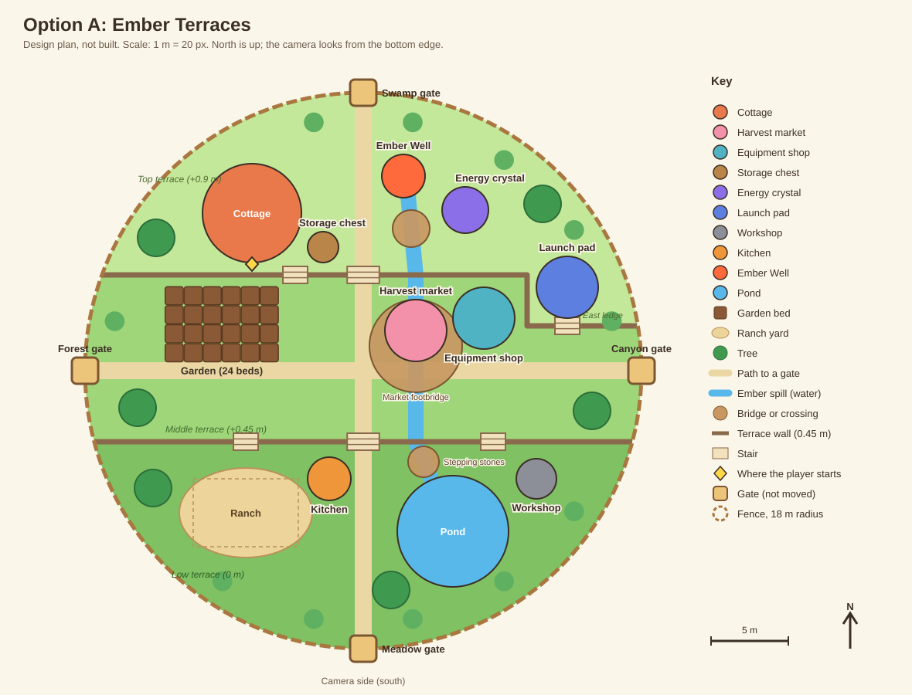
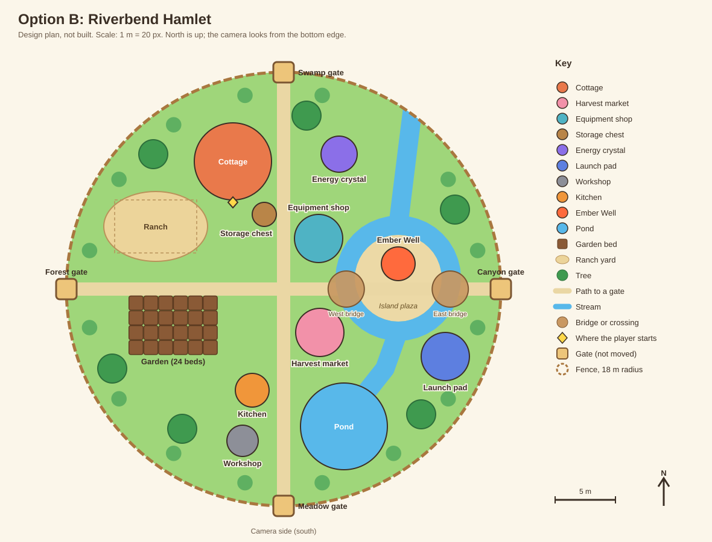

# Zoo Garden: decisions for the owner

Work package WP5 of [the AAA plan](AAA-PLAN.md). Date: 2026-11-21.

This page lists every decision that waits for the owner's yes. **Nothing on this page is built.** No game code changed for it.

## How to answer

- Each decision has a number (D1 to D23). Answer in one line, for example: `D1 B, D4 solo, D9 keep, D14 all default`.
- **If you say nothing, the default applies.** Every default means "the game stays as it is today".
- "Our pick" is what we would choose. It is only advice.
- Cost: S = under a day, M = one work package, L = several packages.
- Round-1 choices that were already taken for you are in [section 8](#8-round-1-defaults-already-taken), each with a way to undo it (R1 to R26).

## Answer sheet

| # | Question | Default (no answer) | Our pick | Cost if yes |
|---|---|---|---|---|
| D1 | A new village shape: A "Ember Terraces", B "Riverbend Hamlet", or keep today's? | Keep today's | **B** | B: 2-3 M. A: 4 M |
| D2 | May saved gardens be moved by the rule in section 1.4? | No move | Yes | Inside D1 |
| D3 | Rename the game (a name without "Zoo")? | Keep "Zoo Garden" | See the private brief | M |
| D4 | Online: go solo-first and retire the classic fight, or host a server? | Both stay as today | Solo-first | M (round 4) |
| D5 | Which repo leads character art? | Not named | Zoo Garden leads | S |
| D6 | Keep the faces on hero models (+4.4 to 5 KB each)? | Keep | Keep | 0 |
| D7 | Port the everyday disguises from the boat edition? | No port | Yes, on-demand kits | M (round 3) |
| D8 | What stays unique to Zoo Garden and is not exported? | Not named | Ember Well story, planets, new hub | S |
| D9 | Bed upgrades: keep 2x per level, or soften? | Keep 2x | 1.6x per level | S |
| D10 | Special offers: keep "any top item for 10,000"? | Keep | Buy-back after the first drop | S |
| D11 | Neighbour gifts: keep rare outfits and disguises? | Keep | Cosmetics and recipes only | S |
| D12 | Farm pen: animals leave after 2 hours, or a ranch where they stay? | Keep the pen | Ranch | M |
| D13 | Defeat: keep the whole bag, or drop only the trip's loot? | Keep the bag | Keep the bag | S |
| D14 | The 16 small tuning questions (section 5.6) | Each row's default | All defaults | S each |
| D15 | Move `PARITY.md` and the reference notes out of the public repo? | Stay public | Yes | S |
| D16 | Reword the 228 source comments that mention the reference? | Stay | Yes, in round 3 | S-M |
| D17 | Ship the new README pitch (draft in section 6)? | Old README stays | Yes | S |
| D18 | Colossus beginner lid: level 15, 20 or 30? | 20 | 20 | S |
| D19 | Automatic Colossus pay: round-1 rule, or always full pay? | Round-1 rule | Round-1 rule | S |
| D20 | A PC-only "Fancy effects" switch? | No switch | Yes, in round 2 | M |
| D21 | Sharper picture on phones when there is headroom? | No change | Yes, after a real-phone test | M |
| D22 | Steady rod: 10% snap chance, or never? | 10% | 10% | S |
| D23 | Free recorded (CC0) sounds next to the synthesized ones? | Synthesized only | Try a few impacts | S |

---

## 1. Our own village hub (D1, D2)

Today's village follows the reference's layout. It is the most visible copied thing in the game. Both options below keep the 18 m fence (`SAFE_RADIUS`, `src/bot-logic.ts:199`) and the four gates on the axes (`src/bot-logic.ts:199-203`), so the wilds, the AI neighbours and the trails outside do not change.

The plans are drawn by a script from one layout table per option, and the same table feeds every number below (the script lives in the git-ignored `.scratch/plan/hub/`).

### 1.1 The two plans

**Option A: Ember Terraces.** Three low terraces step down from the Ember Well toward the camera, so every level shows its face. The cottage sits on top. The well's water spills down through the village to the pond. The market stands on a wide footbridge over the spill. The launch pad has its own ledge in the east.

**Option B: Riverbend Hamlet.** One stream comes in from the north-east, bends around an island plaza and runs out to the pond. The Ember Well stands on the island. Two bridges carry the east path across. The ground stays flat. The garden stays exactly where it is today.

| | A: Ember Terraces | B: Riverbend Hamlet |
|---|---|---|
| Look | Strongest change: height, stairs, a spill of water | Clear change: water, bridges, an island |
| Ground | 3 heights (0, 0.45 and 0.9 m). **The home ground is flat today**, so the hero, friends, pets, beds, decorations, tap-to-walk and the camera all need a height rule first | Flat, as today |
| Garden | All beds move 6 m north, as one block | No bed moves |
| Selling loop (garden to market) | 2.7 s to 1.8 s | 2.7 s to 1.7 s |
| Longest new walk | Start to the meadow gate, 4.7 s | Start to the launch pad, 4.1 s (two bridges) |
| Cost | About 4 M packages | 2-3 M packages |
| Risk | Medium-high (height touches many systems) | Low-medium |

| | |
|---|---|
| **Question (D1)** | Build A, build B, or keep today's village? |
| **Default** | Keep today's village. Nothing is built. |
| **Our pick** | B. It reads as our own place, no bed moves, and it does not need a height system. A is the bolder picture if you accept the extra cost. |
| **Cost if yes** | B: 2-3 M packages in rounds 2-3. A: about 4 M. Then Blender renders of the chosen option first, for your approval. |
| **What the player sees** | A village with its own shape; their beds and decorations are still there (section 1.4). |
| **Cost to undo** | M. The old layout table stays in the code, so a save can be moved back with nothing lost (checked below). The new models would be unused. |

### 1.2 Station tables

These tables would replace `HOME_CLEARANCE` (`src/model.ts:359`) and the positions in `src/world.ts`. Positions are in metres: x to the east, z to the south (the camera side).

| Station | Today (x, z) | A (x, z) | B (x, z) | Keep-off radius |
|---|---|---|---|---|
| Cottage | 0, -8 | -7.2, -10.2 | -4.2, -10.6 | 3.2 m |
| Harvest market | 9, 2.5 | 3.4, -2.6 | 3, 3.6 | 2 m |
| Equipment shop | 9.6, 10.6 | 7.8, -3.4 | 2.9, -4.2 | 2 m |
| Storage chest | -3.3, -4.9 | -2.6, -8 | -1.6, -6.2 | 1 m |
| Energy crystal | 8.5, -7 | 6.6, -10.4 | 4.6, -11.2 | 1.5 m |
| Launch pad | 13.5, -3 | 13.2, -5.4 | 13.4, 5.6 | 2 m |
| Workshop | 5.5, 6.5 | 11.2, 7 | -3.4, 12.6 | 1.3 m |
| Kitchen | 1, 10.5 | -2.2, 7 | -2.6, 8.4 | 1.4 m |
| Ember Well | -7, -11 | 2.6, -12.6 | 9.5, -2.1 | 1.4 m |
| Pond | -7.5, 11.2 | 5.8, 10.4 | 5, 11.4 | 3.6 m |
| Farm pen (6.8 x 4.4 m), centre | -8.6, -5 | -7.6, 9.2 | -10.6, -5.2 | rectangle |
| Garden block (6 x 4 beds), centre | -9.15, 2.99 | -9.15, -3.02 | -9.15, 2.99 | bed grid |
| Where the player starts | 0, -4.8 | -7.2, -6.9 | -4.2, -7.2 | none |
| Village trees (6) | as today | -13.4, -8.6; 11.6, -10.8; -14.6, 2.4; 14.8, 2.6; -13.6, 7.6; 1.8, 14.2 | -10.8, -11.2; -14.2, 6.6; -8.4, 11.6; 1.9, -14.4; 14.2, -6.6; 11.4, 10.4 | 1.2 m each |
| Fence-side bushes (16.4 m ring) | 16 | 11 (5 would stand in a station or water) | 15 | 0.8 m each |

New pieces that beds and decorations must also keep off:

| Piece | A | B |
|---|---|---|
| Water | The Ember spill, 1 m wide: (2.9, -11.3) to (3.4, -6.2) to (3.4, 4.6) to (4.5, 7.3) | The stream, 1.6 m wide: in from (11, -17.4) by (10.2, -11); a ring of radius 4.4 m around (9.5, -0.9); out by (8.4, 6.6) to the pond |
| Crossings | Market footbridge (3.4, -1.6), a step bridge (3.1, -9.2), stepping stones (3.9, 5.9) | West bridge (5.2, 0), east bridge (13.8, 0) |
| Walls | Upper wall along z = -6.2 with the east ledge down to z = -2.9; lower wall along z = 4.6 | None |
| Stairs | Six: (0, -6.2), (-4.4, -6.2), (13.2, -2.9), (0, 4.6), (-7.6, 4.6), (8.4, 4.6) | None |

The script checks each table: no station overlaps another, a tree, the pen, a path or water; everything stays inside the fence; all 24 garden grid spots pass the bed rule. Both options pass.

### 1.3 Walking times

At the hero's base speed of 6 m a second (`src/model.ts:237`), by the shortest way around water and terrace walls. Stations themselves are not counted as obstacles, which adds under 0.3 s to any row.

| Walk | Today | A | B |
|---|---|---|---|
| Start to the garden | 2.0 s | 1.4 s | 1.9 s |
| Garden to the market (the selling loop) | 2.7 s | 1.8 s | 1.7 s |
| Market to the shop | 0.7 s | 0.1 s | 0.6 s |
| Garden to the kitchen | 1.9 s | 2.0 s | 1.2 s |
| Garden to the farm pen | 0.9 s | 2.5 s | 0.9 s |
| Garden to the chest | 1.5 s | 1.2 s | 1.8 s |
| Garden to the pond | 0.8 s | 2.7 s | 2.1 s |
| Start to the Ember Well | 1.3 s | 1.7 s | 2.5 s |
| Start to the launch pad | 1.9 s | 3.2 s | 4.1 s |
| Market to the workshop | 0.3 s | 1.5 s | 1.3 s |
| Shop to the energy crystal | 2.4 s | 2.5 s | 0.6 s |
| Start to the forest gate (west) | 3.1 s | 3.0 s | 2.6 s |
| Start to the meadow gate (south) | 3.8 s | 4.7 s | 4.3 s |
| Start to the swamp gate (north) | 2.2 s | 2.2 s | 1.9 s |
| Start to the canyon gate (east) | 3.1 s | 4.4 s | 4.1 s |

Reading: both options shorten the loop players walk most (garden to market) by about a second. Both make the launch pad a longer walk; in B that is on purpose, because the way leads over the island and past the well.

### 1.4 How saved villages move (D2)

The design, in order:

1. A save gets a `hubLayout` number. A save without one is on today's village (0). The game keeps one layout table per number, the way `GARDEN_LAYOUT` already does for bed sizes.
2. When an older save loads, the move runs once. It is a pure rule on the save, so the server runs the same rule.
3. **Beds in the garden block keep their place in the block.** The whole block moves by the layout's offset (A: 6.01 m north; B: 0 m). Crops, timers, bed levels and turns are kept.
4. A bed the player placed by hand outside the block stays if its spot is still free; otherwise it goes to the nearest free spot.
5. **A decoration stays if its spot is still free; otherwise it goes to the nearest free spot within 8 m.**
6. A decoration with no free spot is packed away by the rule that "Pack away" uses today (`src/decor-move.ts`, `removeDecoration`): into the bag if it fits the bag's 100 kinds, else into the chest's 120 kinds. If both are full it waits in a "moving box" at the chest, outside the slot count, and comes out when there is room. The limits are never broken and nothing is ever deleted.
7. The player gets one small note: "We moved 24 beds and 12 decorations. 2 are in your bag."
8. Undo: the old table stays in the code, so the same rule can move a save back.

**Dry run.** The script runs this rule on copies of the three test saves. Those saves have no decorations, so two worst cases were added: the late save with 80 decorations (the cap) scattered over the whole village and 6 beds moved out of the block by hand, once with roomy storage and once with the bag at 100 of 100 kinds and the chest at 117 of 120.

Option A:

| Save | Beds | Moved with the block | Sent to the nearest free spot | Farthest bed move | Crops kept | Decorations | Stay | Move (farthest) | To bag | To chest | Moving box |
|---|---|---|---|---|---|---|---|---|---|---|---|
| `save-new.json` | 9 | 9 | 0 | 6.01 m | 0 of 0 | 0 | 0 | 0 | 0 | 0 | 0 |
| `save.json` | 24 | 24 | 0 | 6.01 m | 24 of 24 | 0 | 0 | 0 | 0 | 0 | 0 |
| `save-late.json` | 24 | 24 | 0 | 6.01 m | 24 of 24 | 0 | 0 | 0 | 0 | 0 | 0 |
| Worst case, roomy storage | 24 | 18 | 5 | 6.01 m | 24 of 24 | 80 | 33 | 47 (4.53 m) | 0 | 0 | 0 |
| Worst case, storage nearly full | 24 | 18 | 5 | 6.01 m | 24 of 24 | 80 | 33 | 47 (4.53 m) | 0 | 0 | 0 |

Option B:

| Save | Beds | Moved with the block | Sent to the nearest free spot | Farthest bed move | Crops kept | Decorations | Stay | Move (farthest) | To bag | To chest | Moving box |
|---|---|---|---|---|---|---|---|---|---|---|---|
| `save-new.json` | 9 | 0 | 0 | 0 m | 0 of 0 | 0 | 0 | 0 | 0 | 0 | 0 |
| `save.json` | 24 | 0 | 0 | 0 m | 24 of 24 | 0 | 0 | 0 | 0 | 0 | 0 |
| `save-late.json` | 24 | 0 | 0 | 0 m | 24 of 24 | 0 | 0 | 0 | 0 | 0 | 0 |
| Worst case, roomy storage | 24 | 0 | 5 | 2.49 m | 24 of 24 | 80 | 36 | 44 (3.12 m) | 0 | 0 | 0 |
| Worst case, storage nearly full | 24 | 0 | 5 | 2.49 m | 24 of 24 | 80 | 36 | 44 (3.12 m) | 0 | 0 | 0 |

What the numbers say:

- On the three real test saves nothing is packed and no crop is lost. In B nothing moves at all.
- Even with 80 scattered decorations, every one finds a free spot within 5 m, so nothing needs packing.
- The packing path was still tested by switching the free-spot search off. With roomy storage all 47 (A) or 45 (B) displaced decorations go into the bag, which grows from 12 to 32 or 33 kinds of 100. With storage nearly full, A puts 11 in the chest and 36 in the moving box; B puts 10 and 35. No limit is broken.
- Undo check: the worst case moved to A or B and back again ends with all 24 beds, all 24 crops and all 80 decorations placed.

What the dry run does not cover (work for the build, counted in the cost):

- The cottage's inside is anchored to (0, -8) (`src/house.ts`), friends stand at fixed spots such as the kitchen (`src/friend-crew.ts`), and the home pond is in the fishing list (`src/fish-hunting.ts`). Each must read the layout table.
- The tutorial creatures, the stepping stones and the AI neighbours' visiting spots.
- A real save from a real player with decorations. We only have built ones.

| | |
|---|---|
| **Question (D2)** | If a new hub is built, may saved gardens be moved by this rule? |
| **Default** | No move (and so no new hub). |
| **Our pick** | Yes. |
| **Cost if yes** | Inside D1's cost (one of its M packages). |
| **What the player sees** | Their garden in the new village, one small note, nothing lost. |
| **Cost to undo** | S for a save (the rule runs both ways). |

### 1.5 Draw budget

The limit for the village is **294 draw calls and 245,000 triangles** (late save, 42° camera; [evaluation section 7](AAA-EVALUATION.md)). The frozen speed gate measures today's village at 147 main + 76 shadow draws and 206,005 triangles (`promo/perf-baseline.json`, row `village/late/42/desktop-high`).

Triangle numbers below are caps the build must stay under, worked out from the lengths in the layout table (walls 10 triangles a metre, banks 12, water 4, a stair 60, a bridge 250, the market deck 400).

| New piece | A triangles | B triangles | Main draws | Shadow draws |
|---|---|---|---|---|
| Terrace walls (73 m) and 6 stairs | 1,087 | none | 0 | 0 |
| Ground in 3 steps instead of 1 disc | 200 | none | 0 | 0 |
| Bridges and crossings (A: 3, one is the market deck; B: 2) | 900 | 500 | 0 | 0 |
| Island plaza paving | none | 120 | 0 | 0 |
| Banks (A: 19 m of water; B: 43 m) | 226 | 511 | 0 | 0 |
| Water (one flat mesh, the pond's material, no shadow) | 75 | 170 | 1 | 0 |
| All solid pieces merged into one mesh on the village kit material | 0 | 0 | 1 | 1 |
| **Added** | **2,488** | **1,301** | **2** | **1** |

| | Draw calls (main + shadow) | Triangles | Under 294 / 245,000? |
|---|---|---|---|
| Today (measured) | 147 + 76 = 223 | 206,005 | yes |
| A (today + budget) | 149 + 77 = 226 | 208,493 | yes |
| B (today + budget) | 149 + 77 = 226 | 207,306 | yes |

Two honest notes:

- These are budgets, not measurements. Nothing was built, so nothing could be measured.
- The round-1 gate is stricter than 294 / 245,000: its frozen rows may not grow at all. So the hub must be built **after** the round-2 village batch (which is expected to cut about 105 static draws to 12-18), and its pieces join that batch. The village rows are measured in today's village, so a new hub also needs them measured once more, as a named ledger entry you approve.

---

## 2. The game's name (D3)

| | |
|---|---|
| **Question** | Keep "Zoo Garden", or pick a name without "Zoo" before any sale? |
| **Default** | Keep "Zoo Garden". |
| **Our pick** | In the private brief: five names, a quick web check for each, and what a rename touches. The brief is not in this public repo; it is in the owner's private folder `.scratch/owner/NAME-BRIEF.md`. |
| **Cost if yes** | About one M package: text, logo, install name, tests. |
| **What the player sees** | A new title and logo. Their save, settings and link keep working. |
| **Cost to undo** | S. Saved-game keys and the web address are never renamed, so no data is at risk. |

---

## 3. Online play (D4)

Today there are two sets of fight rules. Solo uses the new jump-and-air fight. Online rooms force the classic rules (`airOn()` in `src/main.ts:294-296` switches the new fight off whenever a server is connected), so every fight change must be made twice. No server is hosted.

| | |
|---|---|
| **Question** | Go solo-first and retire the classic fight path, or host a server and keep both? |
| **Default** | Both stay as today. Each new fight feature keeps a classic fallback. |
| **Our pick** | Solo-first for the AAA push. Park online Flag Rush and Rescue co-op; keep the server code in the repo. |
| **Cost if yes** | Solo-first: M in round 4, and every later fight package gets cheaper. Hosting: a monthly bill, upkeep, and the new fight rebuilt on the server (L). |
| **What the player sees** | Solo-first: one fight that feels the same everywhere; the online menu says "paused". Hosting: friends can play together, with the classic fight for now. |
| **Cost to undo** | M. The classic path comes back from git history; the server code is not deleted. |

---

## 4. Character art and what is ours alone (D5 to D8)

| # | Question | Default | Our pick | Cost if yes | What the player sees | Cost to undo |
|---|---|---|---|---|---|---|
| D5 | Sibling games reuse this game's characters. Which repo leads character art: Zoo Garden or `cute_game_boat`? | Not named; each repo copies from the other by hand | Zoo Garden leads; others copy from it | S (a note in both repos) | Nothing now; later, one consistent cast | None (a note) |
| D6 | The faces copied from the boat edition add 4.4 to 5 KB to each hero model. Keep them? | Keep | Keep, and record the size in the bytes ledger | 0 | Heroes keep their faces | S to trim or recompress later |
| D7 | Port the boat edition's everyday disguises (swimmer, singer, yoga teacher, nurse; bear and fox ears)? | No port | Yes, as kits loaded on demand, with a triangle budget per avatar | M in round 3 | More outfits to collect; no slower start | S (kits are separate files) |
| D8 | What stays unique to Zoo Garden and is never exported to sibling games? | Not named | The Ember Well story, the planets, the new hub | S (a list in the README) | Nothing now; the game keeps its own face | None (a list) |

---

## 5. Economy and tuning (D9 to D14)

Nothing in this section changes until you answer. Anything you approve is built in round 2.

### 5.1 Bed upgrades (D9)

Each bed level doubles growth speed, up to level 5: 32 times faster (`src/model.ts:505-510`). The numbers below use the real rules with 24 beds of gold corn, harvested every cycle.

| Option | Speed at level 5 | Energy an hour | XP an hour | Notes |
|---|---|---|---|---|
| Today: 2x per level | 32x | 608,256 | 387,072 | Level 40 needs 115,525 XP in total: under 20 minutes of this garden |
| Softer 1: 1.6x per level | 10.5x | 199,313 | 126,836 | Still clearly worth buying; about a third of today |
| Softer 2: levels 1-3 for energy, levels 4-5 for Rune Seals | 8x until seals are earned, then 32x | 152,064, then 608,256 | 96,768, then 387,072 | The top speed becomes a reward for boss play |
| With either: less XP from crops far below your level | as chosen | unchanged | lower for low crops | Stops radish farming at level 40 |

| | |
|---|---|
| **Question** | Keep 2x per level (your choice in batch 91ded7d), or soften? |
| **Default** | Keep 2x. |
| **Our pick** | Softer 1 (1.6x), plus less XP from crops far below the player's level. Keep the 10,000 welcome gift. |
| **Cost if yes** | S: one constant; beds keep their levels, and crops already growing keep their progress share. |
| **What the player sees** | Upgraded beds are still fast, but levels and energy stop pouring in. |
| **Cost to undo** | S: one constant. |

### 5.2 Special offers (D10)

| | |
|---|---|
| **Question** | The shop sells every boss or crafted item for 10,000 energy, and titan trophies for 25,000 (`src/special-offers.ts:17`). Keep? |
| **Default** | Keep. |
| **Our pick** | Make it a buy-back: an item appears in the offers only after the player has earned it once. |
| **Cost if yes** | S. |
| **What the player sees** | The first copy of a top item comes from the boss, not the shop. Lost or sold copies can still be bought back. |
| **Cost to undo** | S: one check. |

### 5.3 Neighbour gifts (D11)

| | |
|---|---|
| **Question** | AI neighbours give rare outfits and disguises as friendship gifts (`src/bot-logic.ts`). Keep? |
| **Default** | Keep. |
| **Our pick** | Neighbours give cosmetics and recipes; strong gear comes from play. |
| **Cost if yes** | S: the gift table. |
| **What the player sees** | Gifts that are fun to wear, and bosses that are worth fighting. |
| **Cost to undo** | S: the old table. |

### 5.4 Farm pen or ranch (D12)

| | |
|---|---|
| **Question** | Pen animals turn into meat after 2 hours (`ANIMAL_LIFESPAN_MS`, `src/farm.ts`), so a returning player always finds an empty pen. Keep, or build a ranch where animals stay and give products on a timer? |
| **Default** | Keep the pen. |
| **Our pick** | Ranch. |
| **Cost if yes** | M: a save field for the animals, new products, a migration for animals alive at the change. |
| **What the player sees** | Their animals are there when they come back, with eggs and milk waiting. |
| **Cost to undo** | M: the save field stays, and the old rule can read it. |

### 5.5 The bag on defeat (D13)

| | |
|---|---|
| **Question** | A knocked-out player keeps the whole bag unless they switched that off (`keepsBag`, `src/model.ts:851-852`). Boss fights are never lost. Keep, or drop only what was picked up on this trip? |
| **Default** | Keep the whole bag. |
| **Our pick** | Keep. Round 1 already makes bosses sharper; see how that plays first. The softer option stays ready. |
| **Cost if yes** | S: mark items picked up since leaving home; drop only those in the bag left at the spot. |
| **What the player sees** | Softer option: a defeat costs the trip's finds, which wait in a bag where they fell. Seeds, tools and food are safe. |
| **Cost to undo** | S: one setting default. |

### 5.6 The small tuning table (D14)

From [evaluation section 8](AAA-EVALUATION.md). Answer `D14 all default`, or name rows, for example `T2 try 10, T16 never`. Cost S each. For every row the player effect is "this number or rule changes, nothing else", and the undo is one constant.

| # | Question | Default |
|---|---|---|
| T1 | Five-button fight: fire while Attack is held? +10% for specials? Keep the "Attack chain" bench row? | Keep hold-to-fire; no +10%; keep the row |
| T2 | Power strike: 20 hits for 5 basic hits, or 10 for 2.5? | Keep 20 for 5; try 10 for 2.5 once on a real phone |
| T3 | Cooldowns, or one stamina bar for all moves? | Keep cooldowns |
| T4 | Perfect-dodge critical? | Keep it |
| T5 | Strike in the fourth slot? | Closed: the Strike was removed |
| T6 | Shadow Lord takes too long: re-tune, or raise move damage? | Re-tune the boss with its weakness |
| T7 | Crab shield: 15% or 30% of shots pass? Spread splitter children? Next elite? | 30%; spread them; next a flyer; second split stays off |
| T8 | Weapon pair: accept Shadow Lord +6%, keep the 3 s hold? | Yes to both |
| T9 | Sword wind "premium": cosmetic only? +0.4 m reach at +15? | Cosmetic only; no extra reach |
| T10 | Swimming numbers; shots crossing ponds for everyone? | Keep the numbers; yes, one rule for all |
| T11 | Breakables: ice first, 6 wood a day, partial damage heals? | Yes; scenery is hit only when no creature is in reach |
| T12 | Bag: E and the in-place card in the shop too? E takes off a worn item? | Yes to both |
| T13 | Journal: group as Explore / Grow / Collect? | Yes, with the collection book under Collect |
| T14 | Hit feel: light throw 2.8 m or 2 m; elite weight; croc hit radius; titans solid? | 2.8 m until a phone test; elites heavy; fit the croc; titans solid |
| T15 | Rescue Call: 5 or 8 full-pay wins a day; free failure? | Keep 8 and free failure |
| T16 | Steady rod: 10% snap, or never? | The same question as D22 |

---

## 6. Public identity (D15 to D17)

| # | Question | Default | Our pick | Cost if yes | What the player sees | Cost to undo |
|---|---|---|---|---|---|---|
| D15 | [`docs/PARITY.md`](PARITY.md), `PARITY_REVIEW.md` in the repo root and `docs/reference-update-plan-2026-10-02.md` (661 lines in all) list what was matched to the reference. Move them to private notes? | Stay public | Yes. Files are removed going forward; git history is not rewritten | S | Nothing in the game; the repo reads as our own game | S: the files come back from history |
| D16 | 228 lines in `src/` mention the reference, 5 by its product name. Reword them? | Stay | Yes, in round 3 with the identity pass: comments describe our rule, not where it came from | S-M (comments only, no behaviour) | Nothing | None needed |
| D17 | Ship the new README pitch below in place of today's first paragraph ("built against the gameplay of...")? | Old README stays | Yes | S | Visitors read what the game is, not what it copies | S: one file |

**Draft README pitch** (ships only after a yes to D17; the name follows D3):

> # Zoo Garden
>
> A cozy garden at the edge of the wilds, and a starship waiting behind the cottage.
>
> Grow a garden that keeps working while you are away. Cook, fish, craft, and decorate a village that is yours. Then step through a gate: the meadow, the forest, the swamp and the canyon are full of creatures, bosses with their own tricks, and friends who need a way home. Every friend you rescue moves in and lends a hand.
>
> When the Ember Well under the village stirs, follow its sparks to other planets, bring their springs back to life, and come home with something new for the garden.
>
> - Plays in the browser on a phone or a PC. No install, no account.
> - Solo first: your save lives on your device.
> - Original code, art, music and story.

---

## 7. Smaller switches (D18 to D23)

| # | Question | Default | Our pick | Cost if yes | What the player sees | Cost to undo |
|---|---|---|---|---|---|---|
| D18 | The Colossus stays asleep for beginners under level 20 (per device). You named 15 or 30 as other choices | 20 | 20 | S: one constant | 15: the big fight shows up sooner. 30: later | S: one constant |
| D19 | Round 1 pays Automatic players in full for the first Colossus kill and tells them the trade-off; later Automatic kills pay the soothed rate (20% XP plus 2 fire seeds). Or should Automatic always pay in full? | Round-1 rule | Round-1 rule | S: one line | "Always full": the easy path pays like the hard one | S: one line |
| D20 | A "Fancy effects" switch on PC only (never on phones), to hold sway and moving water | No switch | Yes, in round 2 | M | PC players can turn on extra motion; phones are untouched | S: remove a settings row |
| D21 | Phones draw at a low resolution with no smoothing, so edges look stepped. Let the game raise sharpness when the phone has headroom? | No change | Yes, but only after a test on a real phone and with a phone row in the speed gate | M | Smoother edges on good phones | S: one flag |
| D22 | The steady rod's line still snaps 10% of the time (`src/fishing.ts`; bamboo 60%, golden 30%) | 10% | 10% | S: one constant | "Never": the best rod never loses a fish | S: one constant |
| D23 | Round 1 sounds are all synthesized (0 bytes). Add a few free recorded sounds (CC0 licence) for impacts? | Synthesized only | Try a few in round 2, loaded after Start, each with its source and licence listed in `docs/SOUNDS.md` | S | Hits with more weight | S: delete the files |

---

## 8. Round-1 defaults already taken

These were decided for you so round 1 could move. Each is small and easy to undo. To undo one, answer `undo R5` (for example).

| # | Topic | Default taken | How to undo |
|---|---|---|---|
| R1 | Tone | Cozy life at the centre, with real action trips beyond the gates; the story is told through the village | Nothing to undo; it only guides writing |
| R2 | Music for round 1 | A live score from the theme's own instruments plays first; your theme recording takes over in the village; the title stays quiet. Generated tracks come in round 2 and you pick the takes | One flag sets "theme only" |
| R3 | Level-up and reward moments | Quick level-ups merge into one 1.3 s ribbon on the top edge; rewards fly from the tracker; no pop-ups in the middle of the screen | A setting brings back the quiet flash |
| R4 | Story rewards collect themselves | Yes, when the step is done and things are calm, at most one every 2 s; the button stays | One flag |
| R5 | Default name "Clover" | The title suggests an original name with a dice; old saves unchanged; the farmer is shown as Barley | Remove the suggestion; revert one name |
| R6 | Our own names | 4 skills and 17 bosses now, ids unchanged; planet names in round 3; the game's name does not change | Revert one table and its Vietnamese keys |
| R7 | README pitch and PARITY.md | A draft only (section 6); nothing ships until you say yes | Nothing to undo |
| R8 | Story source | Homeward Book tone for the home arc, ember springs for the planets, on your rescue motif; written fresh | Scenes are data; Settings has "Story scenes: Off" |
| R9 | When Pepper arrives | As today: the first harvest by hand brings her home with the 10,000 energy; before that she writes postcards | Nothing to undo (scene data) |
| R10 | Where seen scenes, medals and new settings are remembered | On the device, per profile slot; no save or server change | Add a save field later (S) |
| R11 | Home boss re-tune (solo) | King Bear and the treant only: 25% less health, phases at 60% and 30%, a signature move, a weakness with a ground way; online keeps the old table | Switch the solo module off |
| R12 | Colossus rewards | Wild: full. "Soothe it": 20% XP plus 2 fire seeds. Automatic: first kill in full, later kills at the soothed rate. Asleep: 1 Fertilizer a day. Lid at level 20 | One line makes Automatic always pay in full (D19) |
| R13 | When Attack swings instead of "use" | An angry creature within 8 m, a hostile within 6 m, or the tutorial fight step; otherwise Attack is still "use" | One condition and two constants |
| R14 | Tutorial bite | Only when standing in the ring; never below 60% health | One constant |
| R15 | Keyboard guide | Open for a new player; folds after the first planting, 3 minutes or 30 keys; a choice by hand is final | One constant |
| R16 | Screen shake and flashes | Shake Full by default, Low under reduced motion, Off available; Flashes On or Low; no hit-stop on Battery saver | Defaults in the settings rows |
| R17 | Pose maths on phones | Counted as tiny CPU work: the walk blend always runs; fidgets and poses stop on Battery saver | One check |
| R18 | Crops | Keep your 2D cards, drawn at the player's camera angle with the new ink, capped to their bed | Two constants |
| R19 | Our own colour ramp | One shader change; item icons keep the old steps for round 1; round 2 redraws the icons | One flag (`perfFlags.ownRamp`) |
| R20 | Bounty cap | Bounties only up to the player's level + 1 | One constant |
| R21 | Boss intro card | Full card on the first meeting, then at most once a day; a name chip otherwise | Constants in `boss-moments.ts` |
| R22 | Moved to round 2 | The village batch, time of day, the camera pass, boss kit 1, robot and croc signature moves, friend requests, the hero's face | Nothing in round 1 |
| R23 | Speed gate | Exact limits on frozen rows; growth only through named ledger entries; the baseline is never raised | Nothing to undo (it is stricter) |
| R24 | Offline install list | Its own limit, lowered when audio moves to on-demand; new lazy files only through named allowances | Nothing to undo (it is stricter) |
| R25 | Bytes before Start | Small allowances per package (5.5 KB at most), paid back by moving rarely used dialogs out of the start code | If a dialog cannot move, the next largest takes its place |
| R26 | Story steps and the tuning table | Story steps unchanged; the tuning table (5.6) waits for your answer | Nothing to undo |

---

## 9. Tools and housekeeping

- **Name check.** `.scratch/plan/name-check.mjs` (git-ignored, never committed) reads the private reference notes and flags a new name that matches a reference name: the same words, the same words in another order, the Vietnamese or English twin from our own catalog, a synonym ("Lord Bear" for "King Bear"), or a spelling one letter away. It fails the run on a match. Its self-test plants five such names and one invented name; all six come out right. Later packages run it on every new skill, boss, planet and item name. It uses our own word lists, not a translation service, so a person still reads the list.
- **The owner's folder.** `.scratch/owner/` holds the owner's private deliverables (now: `NAME-BRIEF.md`). It is git-ignored and is **never cleaned** by any package or cleanup step.
- **The hub script.** `.scratch/plan/hub/` (git-ignored) holds the layout tables and the script that draws both plans and produces every number in section 1. Run from the repo root: `node --experimental-strip-types .scratch/plan/hub/hub.mjs`.

## What was not done

- No hub was built or rendered in 3D; the plans are top-down drawings. Blender renders of the chosen option come first if D1 is yes.
- The draw budget is a budget, not a measurement.
- The name candidates had a quick web search each, not a trademark search.
- The dry run used built saves; no real player save with decorations was available.
